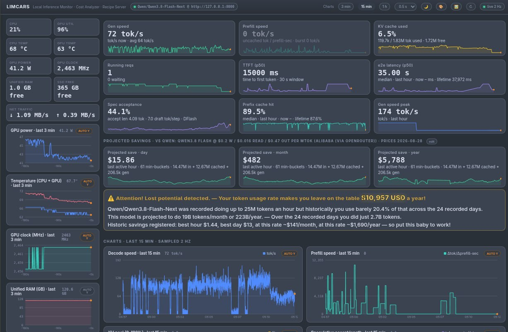
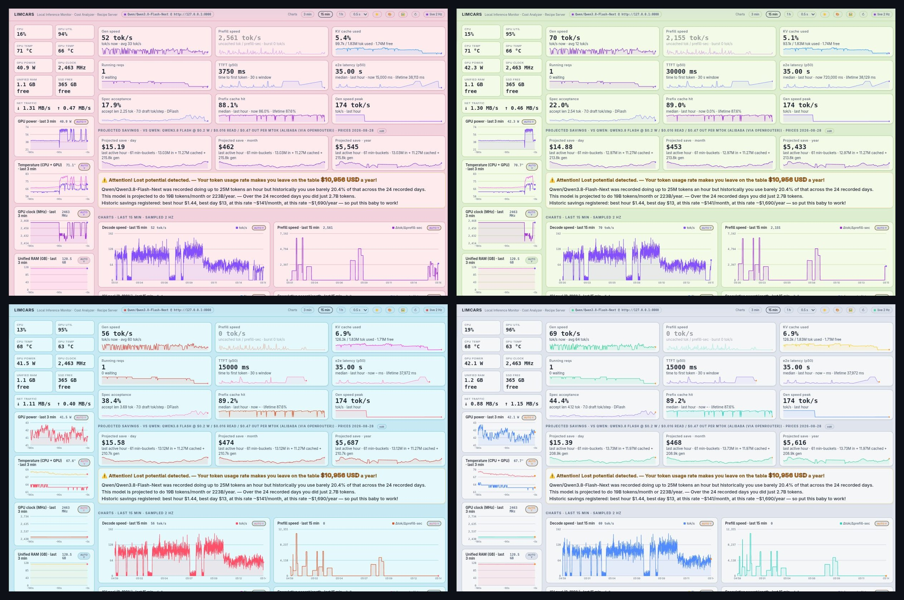
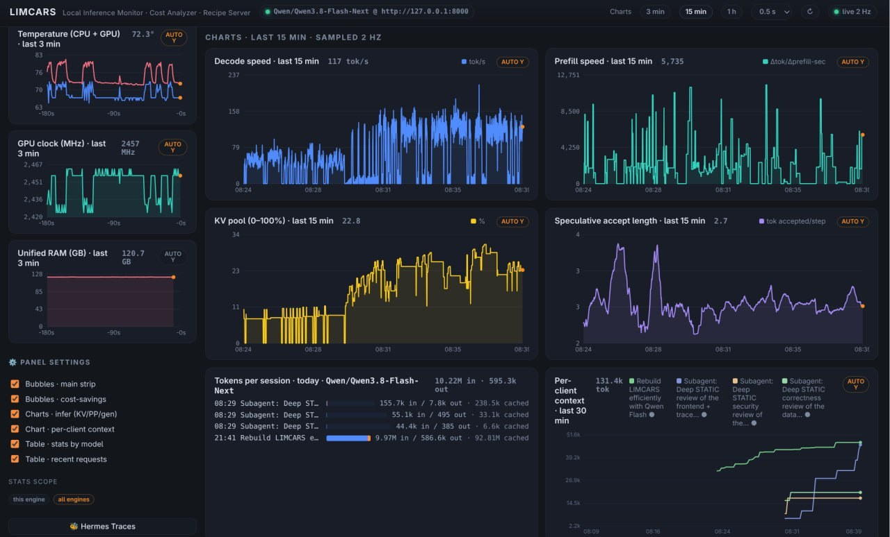
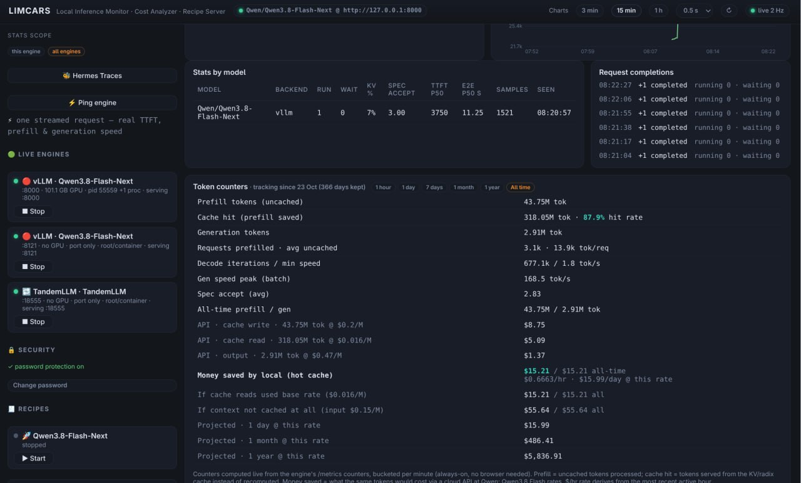
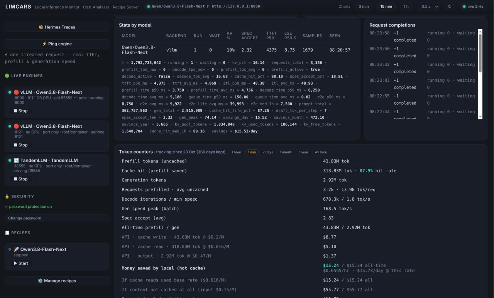

# 🚗 LIMCARS

**L**ocal **I**nference **M**onitor · **C**ost **A**nalyzer · **R**ecipe **S**erver

Your **DGX Spark**, finally with a dashboard that tells the truth. Built and
tuned on a GB10 Spark, at home on any Linux inference rig: LIMCARS watches
your self-hosted LLM engines 2× per second and paints a live dashboard —
speeds, KV cache, thermals, hardware, token ledgers and real **money saved vs
cloud pricing** — plus a one-click recipe launcher for the engines themselves.

⚡ One Python process · 🧩 zero dependencies beyond `psutil` · 📡 no cloud, no telemetry, no accounts

> 🧪 **Honest status:** LIMCARS is developed and **tested on a single NVIDIA
> DGX Spark** (GB10, unified memory). It is designed to run anywhere Python 3
> does, but many features (the non-vLLM engine dialects, Hermes Traces, the
> recipe server under unusual setups) and any **hardware other than the Spark
> need further field testing** — if something misbehaves on your rig, open an
> issue, don't suffer in silence.

```bash
python3 -m app          # → http://localhost:8951
```





## ✨ What you get

### 📊 Live dashboard
- **Bubble strip** of everything that matters: decode & prefill tok/s, KV cache
  in tokens, running requests, TTFT, end-to-end latency, speculative
  acceptance, prefix-cache hits, peak gen speed — pushed live over SSE, no
  polling loops.
- **Hardware sidebar**: CPU/GPU utilization, temperatures, power, clocks,
  unified RAM, SSD and network ↓↑ — each with its own sparkline, smart axes
  and hover readouts.

> ⚠️ **Hardware scope**: the hardware tiles are designed for a **single
> DGX Spark** (GB10 unified memory, local `nvidia-smi`/hwmon). Everything
> *inference-related* — engines, token ledgers, money saved, probes, session
> stats — works perfectly across Spark clusters and multi-GPU rigs (point it
> at any number of engine URLs). The hardware sidebar, though, always
> reflects only the one machine LIMCARS itself runs on. The RAM tile is
> system memory (psutil) — on a Spark that is genuinely the pool your LLMs
> eat, on a normal PC it's plain system RAM. **VRAM is not shown**: a Spark
> has no discrete VRAM (`nvidia-smi` reports `N/A` by design), and a VRAM
> tile for discrete-GPU cards is not yet implemented — until then the
> engine's own KV-cache tiles are the best proxy for what the model actually
> reserved on the GPU.
- **Honest lights**: prefill/decode bubbles glow only while the engine is
  genuinely in that phase; idle latency holds its last real value instead of
  lying with a fat zero.
- 🎯 **Engine probe**: run a real streamed completion and see true TTFT,
  prefill and decode speed — measured, not estimated.

### 💰 Cost & tokens
- Per-model token ledger (write / cache-read / decode) in 1-minute buckets,
  kept for a year, reconciled to the engine's own counters to 0.00 %.
- Projected **$/day and $/year saved vs the equivalent cloud API**, computed
  from your last active hour at market prices.
- 🏦 **Daily money-saved chart** with week / month / 3-month / year switch —
  one color per model, hover for per-model cost and the full write/read/decode
  token split, totals across all models.



### 🍳 Recipe server
- Save each engine launch command as an emoji-named recipe and
  **Start / Stop from the sidebar** — per-recipe detached logs included.
- 🛰️ **Live engine detection** scans GPU compute apps, listening ports and
  process groups, so stray engines show up with their own Stop button.

### 🕵️ Hermes Traces (bonus)
If [Hermes Agent](https://hermes-agent.nousresearch.com) sessions live on your
box, LIMCARS doubles as a two-pane live browser of agent & subagent
transcripts — tailing logs, summaries, session stats, export.



## 🔌 Works with your engine

Engine kind is **auto-detected** — mix and match engines with zero
configuration. Missing metrics degrade to `–`, never to fake zeros.

| Engine | Support |
|---|---|
| 🟣 vLLM (v1) | full — counters, histograms, KV cache, spec decode |
| 🔶 SGLang | full — true live prefill rate |
| 🧊 exl3 | full — exact prefill/generate pairing |
| 🧮 TensorFold | full — dual metric families, spec decode |
| 🦙 llama.cpp | basic — running requests + token counters |
| 🔁 TandemLLM-family | **work in progress** — inflight + token counters |

> **TandemLLM detection is still work in progress.** It is recognised only when
> the engine advertises the `qse_*` metric names; a stock build that reuses plain
> vLLM metric names is auto-detected as vLLM, which keeps the throughput panels
> working but leaves the latency bubbles empty until its metric surface settles
> upstream. Everything else degrades to `–`, never to fake numbers.

Prefill speed is measured **honestly**: prefix-cache hits are excluded and each
engine family is read through the most exact counter pairing it offers — so you
never see the phantom "100k tokens in half a second" spikes other dashboards
happily plot. 🧮



## 🚀 Quick start

```bash
git clone https://github.com/AgentSparko/LIMCARS.git
cd LIMCARS
python3 -m pytest tests/ -q     # 165 tests, stdlib pytest, no GPU/network/engine needed
python3 -m app                  # open http://localhost:8951 🎉
```

**Requirements:** Python ≥ 3.10 and `pip install psutil` — that's it. Linux,
any NVIDIA/AMD/CPU box. No npm, no CDN, no database server.

Engines are discovered automatically from listening OpenAI-API ports; to pin
one explicitly, edit `data/config.json`:

```json
{ "engines": [ { "name": "MyModel", "url": "http://127.0.0.1:8000", "model": "org/model" } ] }
```

Handy environment variables:

| Variable | Default | Meaning |
|---|---|---|
| `LIMCARS_HOST` | `127.0.0.1` | bind address -- local-only by default; set `0.0.0.0` to reach the dashboard from your LAN |
| `LIMCARS_PORT` | `8951` | dashboard port |
| `LIMCARS_DB` | `data/limcars.db` | history database path |
| `LIMCARS_TOKEN` | unset | shared token required by the read/trace endpoints (`app/config.py`); the password in the header is the usual way to get the same protection -- this exists so a headless box can be gated before anyone opens the UI |

## 🔁 Autorun — survive reboots, forget about it

### systemd (recommended)

```bash
sudo cp scripts/limcars.service /etc/systemd/system/
sudo nano /etc/systemd/system/limcars.service   # set User= and WorkingDirectory= to your clone path
sudo systemctl enable --now limcars
```

Starts at boot ✅ restarts itself on failure ✅ plays nice under load (`Nice=5`) ✅
Watch it with `systemctl status limcars` or `journalctl -u limcars -f`.

### cron @reboot (no systemd?)

```bash
crontab -e
# add one line:
@reboot cd /path/to/LIMCARS && /usr/bin/python3 -m app >> data/server.log 2>&1
```

Want a dry run before installing anything system-wide?
`bash scripts/boot-test.sh` boots LIMCARS on a scratch port and asserts the
health endpoint and dashboard answer. 🔍

## 🧬 Had another dashboard before? Bring your history

Don't start from zero — LIMCARS can absorb the measured usage your previous
dashboard recorded (token totals per minute), so the Lost-potential bubble 💡
and daily money-saved chart 📈 have real history from day one.

**Just tell your AI agent:**

> "I used <old dashboard name> on this machine before LIMCARS. Read
> `AGENTS.md` in the LIMCARS repo and migrate my history from it."

The agent gets a complete contract there: the exact
`counter_buckets` schema, the field-mapping traps (cached vs prompt is the
one everyone trips on), the no-double-count and measured-data-only rules,
and a verify-before-claiming loop. `scripts/import_legacy_history.py` ships
as a worked reference — an event-table-style source with per-request rows
(prefill + decode events, cached tokens tracked separately) — and it's also
how this repo's own history got populated. Every source dashboard
needs its own mapping pass — but that is precisely the kind of work a coding
agent does well. 🤖

## 🔐 Security

- 🔒 One shared password (set from the sidebar) guards recipe add/edit/delete
  and Hermes trace data. Start/Stop, probe and the dashboard stay open for
  convenience; localhost is exempt.
- 🧱 Escalating per-IP lockout — 3 wrong tries → 1 min, 6 → 5 min, 9 → 30 min,
  12 → 2 h. Passwords are stored as salted **scrypt** hashes and compared in
  constant time.
- 🔒 **The dashboard binds to `127.0.0.1` by default.** The recipe server
  executes stored commands as the user running LIMCARS, so a dashboard reachable
  from your LAN without a password is a remote code execution path for anyone on
  your network -- the guest on the wifi, the smart fridge. Binding loopback first
  means the safe thing is what you get if you change nothing.
- 🔒 **Writes fail closed.** With no password configured, any *non-local* write is
  refused with HTTP 428 and a message saying what to do. Local requests
  (loopback, including a browser on the same machine) keep working with no setup,
  because the usual case is you, on the box, configuring your own rig.
  There is deliberately **no environment variable that turns this off** -- an
  unauthenticated remote write here is remote code execution, so recipes stop working
  from other machines until you set a password. The supported way to drive the
  dashboard from your phone is: set a password (padlock in the header), then bind
  `LIMCARS_HOST=0.0.0.0` in `data/config.json`.
- 🔒 **The control plane needs the password too**, from anywhere but loopback:
  starting or stopping a service, stopping an engine process, and editing the
  cloud price table. The last one matters because those prices are the baseline
  every "money saved" figure is measured against -- leaving them open lets
  anything on the LAN rewrite your savings numbers.


## 🕊️ Data & privacy

Everything stays on your box. `data/` (history, settings, recipes, password
hash, logs) is gitignored and never leaves the machine. LIMCARS makes no
outbound requests except to the inference engines you point it at. 🏠

## 🤝 Contributing

Fork → branch → `python3 -m pytest tests/ -q` before opening a PR — dialects,
auth lockout and counter conservation all have tests. Bug reports with an
engine name + `/metrics` snippet are extra welcome. 🙏

## 📜 License

MIT — see [LICENSE](LICENSE).
